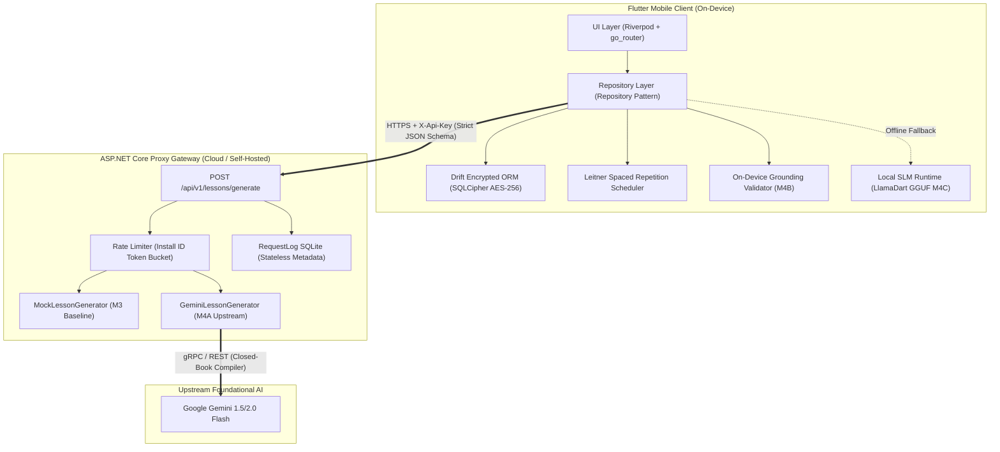

# System Architecture and Component Topology

This document details the high-level system architecture, data isolation boundaries, and component interactions of the NeuroScript AI platform.

---

## 1. System Topology Overview (Figure 5.1)

NeuroScript AI adopts an offline-first, privacy-preserving hybrid cloud architecture. The Flutter mobile application performs local cryptographic persistence, spaced repetition scheduling, and UI rendering on-device. An ephemeral ASP.NET Core proxy manages rate limiting, authentication, and communication with the upstream Google Gemini LLM compiler.

---

## 2. Core Architectural Principles

1. **Privacy by Design:**
   * Raw handwritten notes and student study cards are encrypted at rest using SQLCipher AES-256 with keys stored in hardware-backed keystores (`flutter_secure_storage`).
   * The backend proxy is completely stateless for study contents: it logs request metadata (install hash, timestamp, token usage, latency), never note text or card bodies.
2. **One Universal Contract:**
   * The JSON Schema contract defined in `docs/contracts/lesson.schema.json` governs all generators (Seed JSON, Mock Generator, Gemini Cloud Generator, and On-Device SLM Fallback).
3. **Graceful Degradation:**
   * When internet connectivity is absent or the proxy returns HTTP 429 / 5xx, the client seamlessly shifts from cloud synthesis to on-device cached lessons or local SLM generation.
