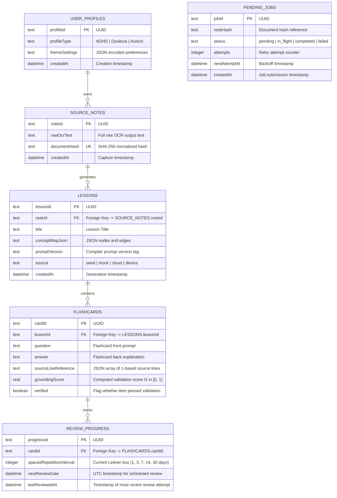
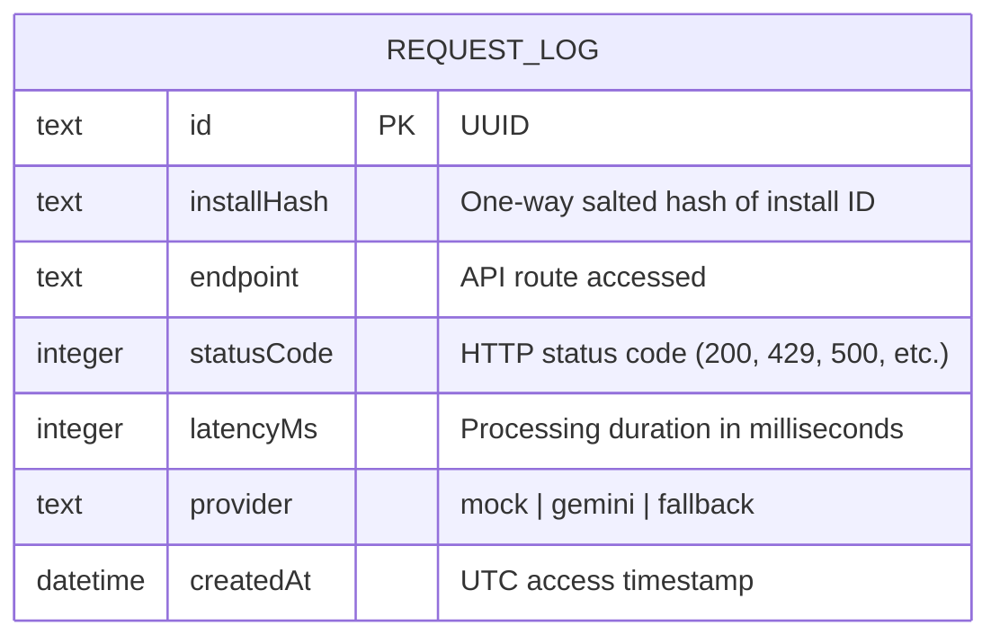

# Entity Relationship Diagrams (Appendix A)

This document specifies the database schemas for both the on-device encrypted database (Figure 5.2) and the ephemeral proxy metadata store (Figure 5.3).

---

## 1. On-Device Encrypted Database (Figure 5.2)

The client database is implemented via Drift and encrypted using SQLCipher AES-256. All foreign keys enforce cascading deletions to preserve relational integrity.

---

## 2. Backend Proxy Audit Store (Figure 5.3)

The ASP.NET Core proxy persists exclusively privacy-compliant telemetry and metadata in an internal SQLite database (`RequestLog`). No user notes or generated card contents are stored.

