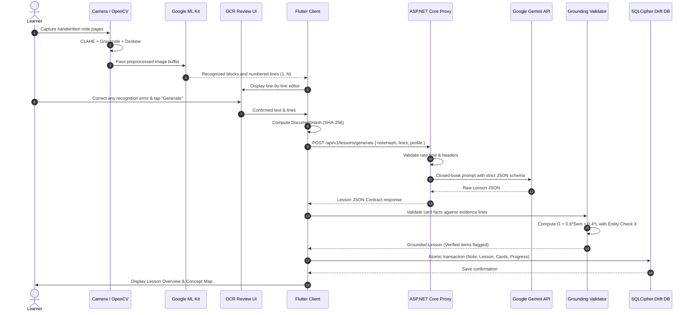
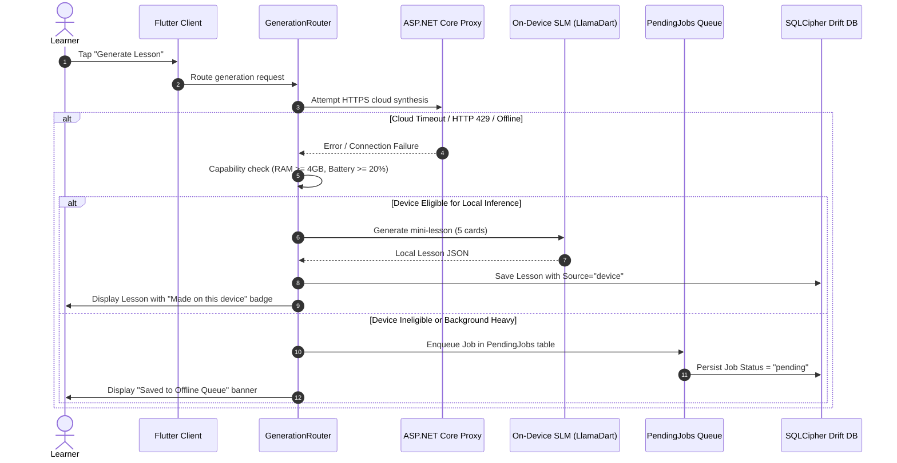

# System Sequence Diagrams

This document illustrates the execution lifecycle across the online generation flow and the offline/degraded fallback pathway.

---

## 1. Sequence 1: Camera Scan to Grounded Lesson Generation

Illustrates the end-to-end workflow: note capture, on-device OCR, line numbering, cloud generation, grounding verification, and encrypted storage.

---

## 2. Sequence 2: Cloud Failure, On-Device Fallback & Offline Queue

Illustrates the fault-tolerant resilience path when network connectivity is severed or the proxy rate limit is reached.

